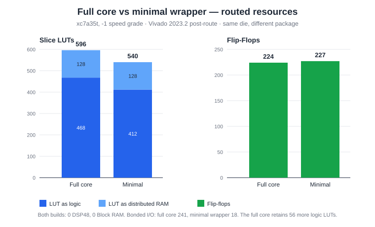

<div align="center">

# RISC-V Processor

[](https://github.com/muditbhargava66/RISC-V-Processor-Verilog/actions/workflows/ci.yml)
[](https://github.com/muditbhargava66/RISC-V-Processor-Verilog/blob/main/LICENSE)
[](https://github.com/muditbhargava66/RISC-V-Processor-Verilog)
[](https://www.xilinx.com/products/silicon-devices/fpga/artix-7.html)
[](https://riscv.org/specifications/)

Single-cycle RV32I processor (multi-cycle RV32M divide) implemented in SystemVerilog with Vivado and Quartus build flows. RV32 only.

</div>

## Status

- Core RTL, testbenches, and build scripts maintained in this repository
- Canonical test program in instruction_memory.hex
- Debug-oriented core (riscv_processor) exposes wide debug ports for simulation
- Minimal wrapper (riscv_processor_minimal) fits Basys3 I/O budget
- JTAG debug wrapper (riscv_processor_jtag_debug) includes explicit ILA and VIO instantiation
- Verification infrastructure includes unit tests, system tests, compliance checks, formal verification, and benchmarks

## Repository Layout

```
src/                          Processor RTL
  riscv_processor.sv          Core with simulation/debug ports
  riscv_processor_minimal.sv  Basys3-oriented low-I/O wrapper
  riscv_processor_jtag_debug.sv  JTAG debug wrapper with ILA/VIO
testbenches/                  Unit and system testbenches
instruction_memory.hex        Canonical test program
verification/                 Formal verification and compliance checks
benchmarks/                   Performance benchmark testbench
scripts/                      Vivado and Quartus Tcl entry points
constraints/                  XDC (Xilinx) and SDC (Intel) constraint files
docs/                         Documentation
build/                        Generated Vivado/Quartus projects (gitignored)
```

## Requirements

- Xilinx Vivado 2023.2 or compatible 7-series release (target: xc7a35tcpg236-1 Basys3)
- Intel Quartus Prime 23.1 or later (for SDC flow)
- GNU Make (optional, convenience wrapper around Tcl scripts)
- SymbiYosys and solvers (Yices2, Z3, Bitwuzla) for formal verification

## Getting Started

### Prerequisites

- Xilinx Vivado Design Suite 2023.2 or later
- Target FPGA: Xilinx Artix-7 XC7A35T (Basys3 board recommended)
- Git and GNU Make

### Quick Start (Recommended)

```bash
# 1. Clone the repository
git clone https://github.com/muditbhargava66/RISC-V-Processor-Verilog.git
cd RISC-V-Processor-Verilog

# 2. Run lint check (verifies syntax and elaboration)
make lint

# 3. Run all directed tests (functional gate)
make test-all

# 4. Build minimal wrapper bitstream for Basys3
make implement-minimal
```

### Running Individual Tests

```bash
# Directed RTL tests
make test-alu
make test-control
make test-regfile
make test-memory
make test-system

# Optional diagnostic checks
make test-compliance
make test-formal
make test-benchmark

# Lint/synthesis check only
make lint
```

### Without Make (Direct Vivado)

```powershell
# System test
vivado -mode batch -source scripts/run_simulation.tcl -tclargs system

# ALU test
vivado -mode batch -source scripts/run_simulation.tcl -tclargs alu

# Other targets: control, memory, regfile, compliance, formal, benchmark
vivado -mode batch -source scripts/run_simulation.tcl -tclargs <test_name>
```

### FPGA Build Flow

1. **Lint check first** (catches syntax/elaboration errors early):
   ```bash
   make lint
   ```

2. **Implement minimal wrapper** (creates bitstream for Basys3):
   ```bash
   make implement-minimal
   ```
   Output: `build/vivado/riscv_processor_minimal/riscv_processor_minimal.runs/impl_1/riscv_processor_minimal.bit`

3. **Optional: JTAG debug build** (includes ILA/VIO cores):
   ```bash
   make implement-jtag
   ```

### Program Images

Instruction memory is word-addressed by `address[ADDR_WIDTH+1:2]`. One 32-bit hex instruction per line, first line maps to PC `0x00000000`. The repository uses `instruction_memory.hex` for the self-checking system program.

Keep images in explicit, version-controlled locations and update test/build configurations. Synthesis and implementation runs must declare the image, otherwise memory contents are tool- and directory-dependent.

## Architecture

- Harvard-style instruction and data memories
- 32 general-purpose registers, x0 hardwired to zero
- Single-cycle datapath and control; RV32M divide/remainder use a multi-cycle
  sequential divider that stalls the core (~32 cycles)
- RV32 only (`XLEN=32` enforced at elaboration)
- Tests cover ALU operations, decoding, register file, memory access, the divider,
  and a small integration program

The decoder and RTL cover RV32I base instruction categories. Full ISA conformance requires the official RISC-V Architectural Test suite, an explicit execution environment, and reproducible pass logs.

## Implementation Results (verified v1.2.0)

> Reproduced from actual Vivado 2023.2 runs on the `minimal` target
> (xc7a35tcpg236-1, Basys3). Reports are written to `build/reports/` by
> `make synthesize` / `make implement-minimal` (build artifacts, not committed).
> These supersede the old v1.1.0 estimate tables: removing the data-memory reset
> loop and adding the clock divider changed the resource counts substantially.

### Flow status

| Stage | Result |
|-------|--------|
| Synthesis (`synth_design`) | Complete — 0 errors, 0 unsupported-primitive warnings |
| Implementation (`opt/place/route`) | Complete — `Router Completed Successfully` |
| Bitstream (`write_bitstream`) | Complete — `riscv_processor_minimal.bit` (~2.1 MB) |
| DRC (`report_drc`) | 0 violations |
| Methodology (`report_methodology`) | 0 violations |

### Resource utilization (post-route)

| Resource | Used | Available | Utilization |
|----------|------|-----------|-------------|
| Slice LUTs | 540 | 20,800 | 2.60% |
| — LUT as logic | 412 | 20,800 | 1.98% |
| — LUT as distributed RAM | 128 | 9,600 | 1.33% |
| Slice registers (FF) | 227 | 41,600 | 0.55% |
| Block RAM | 0 | 50 | 0% |
| DSP48E1 | 0 | 90 | 0% |
| BUFG | 2 | 32 | 6.25% |
| Bonded I/O | 18 | 106 | 16.98% |

The 227 FFs are 225 synchronous-reset core registers plus 2 asynchronous-set
reset-synchronizer flops. The memories infer as **distributed RAM** (128 LUTs),
not Block RAM: the single-cycle datapath reads memory combinationally in the
same cycle, which Block RAM (synchronous read) cannot satisfy without a pipeline
stage. The RV32M multiplier maps to LUTs/CARRY4, not DSP48. RV32M divide/remainder
use a sequential restoring divider (`src/divider.sv`); moving the divide out of
the combinational ALU reduced logic LUTs versus the earlier combinational divider.

### Timing (post-route — all constraints met)

Core clock `clk_core` = 50 MHz (20 ns), generated by dividing the 100 MHz board
clock `sys_clk_pin` (toggle flop + BUFG).

| Metric | Value | Status |
|--------|-------|--------|
| WNS (setup) | +4.134 ns | MET |
| TNS | 0.000 ns (0 / 1922 endpoints) | MET |
| WHS (hold) | +0.081 ns | MET |
| THS | 0.000 ns (0 / 1922 endpoints) | MET |
| WPWS (pulse width) | +4.500 ns | MET |

`report_timing_summary`: **"All user specified timing constraints are met."**
The worst core path (~15.9 ns) is the single-cycle datapath including the
divider's registered iteration logic; the design has margin to ~63 MHz but is
constrained at 50 MHz. `check_timing` reports 0 unconstrained endpoints, 0
combinational loops, and 0 disconnected generated clocks; the only notes are the
intentional false-path exceptions on the async reset input and the 16 LED outputs.

### CDC / clock interaction

- `report_cdc`: 1 crossing (async reset port → `clk_core`), **Safe = 1,
  Unsafe = 0, Unknown = 0, No ASYNC_REG = 0** — handled by the 2-FF `ASYNC_REG`
  reset synchronizer and a `set_false_path` exception.
- `report_clock_interaction`: both clock pairs **Clean / Timed**; the inter-clock
  table is empty (no data paths cross between the 100 MHz divider flop and the
  50 MHz core).

### Power (vector-less estimate, medium confidence)

| Metric | Value |
|--------|-------|
| Total on-chip power | 88 mW |
| Dynamic | 16 mW |
| Device static | 72 mW |
| Junction temperature | 25.4 °C |

### Full-core characterization

The numbers above are for the Basys3 minimal wrapper, which trims unexposed core
logic to fit the board's 106 I/O. `make full-core` synthesizes and implements the
complete `riscv_processor` (all 241 debug I/O retained) on `xc7a35tfgg484-1` — the
same xc7a35t die and -1 speed grade as Basys3, in a larger 250-I/O package. The
routed full core uses **596 LUTs (468 logic + 128 distributed RAM), 224 FF, 0 DSP /
0 BRAM**, meets 50 MHz with **WNS +5.462 ns**, and estimates **95 mW**. See
[Full-core characterization](docs/fpga/full-core-characterization.md) for the
comprehensive report set and the wrapper-vs-core comparison.



## Verification

### Directed Tests (Functional Gate)

```bash
make test-all
```

| Test | Scope | Result |
|------|-------|--------|
| `test-system` | Full program execution | 6/6 register checks PASS |
| `test-alu` | 21 ALU vectors (RV32I + RV32M multiply) | 21/21 PASS |
| `test-control` | 45 decode vectors (RV32I + RV32M) | 45/45 PASS |
| `test-memory` | I-MEM/D-MEM access patterns | 18/18 PASS |
| `test-regfile` | Register read/write, x0 behavior | 37/37 PASS |
| `test-immgen` | I/S/B/U/J immediate generation | 8/8 PASS |
| `test-pc` | PC reset/update/hold (stall) | 8/8 PASS |
| `test-divider` | RV32M divide: corners, directed, 200 random, handshake | 884/884 PASS |

### Diagnostic Checks

```bash
make test-compliance   # Directed ISA compliance harness (41 checks PASS)
make test-formal       # SVA assertion simulation (14 inline assertions; xsim ignores covers)
make test-benchmark    # Bounded diagnostic: 11 non-NOP instr / 14 cycles, IPC ~0.786
```

### Formal Verification (SymbiYosys)

```bash
sby -f verification/formal.sby      # Prove (smtbmc + abc pdr, unbounded)
sby -f verification/formal_bmc.sby  # Bounded model checking
sby -f verification/formal_cover.sby # Coverage collection
sby -f verification/formal_core.sby  # Core-only prove
```

**SVA Properties:** 14 assertions + 15 cover properties (inline in `riscv_processor.sv`, simulation-only). xsim evaluates the assertions but ignores `cover property`; the covers are exercised by the SymbiYosys cover flow. The Yosys-friendly formal contract lives in `verification/riscv_processor_sva.sv` (4 assertions + 3 covers).

**Formal results (verified v1.2.0, OSS CAD Suite):** all four configs PASS — `formal.sby` and `formal_core.sby` prove the wrapper assertions unbounded (abc pdr, <1 s); `formal_cover.sby` reaches all 3 cover points; `formal_bmc.sby` passes to depth 12 (bitwuzla). The frontend is `read_slang` (yosys-slang), required for the SV package/enums.

### Lint/Synthesis Check

```bash
make lint
```

**Result:** SYNTHESIS PASSED (0 errors, 0 critical warnings). The standalone-core
lint reports 59 benign warnings: 50 unused debug port/signal warnings (the core's
wide debug ports have no load when synthesized alone), 7 package-parameter-as-
localparam notes, 1 zero-replication note (the RV32 U-type sign-extension), and 1
parallel-synthesis info. Verilator `--lint-only -Wall --assert` is clean (0 warnings).

## Documentation

- [Verification guide](docs/verification/verification-guide.md)
- [Change log](CHANGELOG.md)
- [Version roadmap](VERSION_ROADMAP.md)

## License

This project is licensed under the [MIT License](LICENSE).