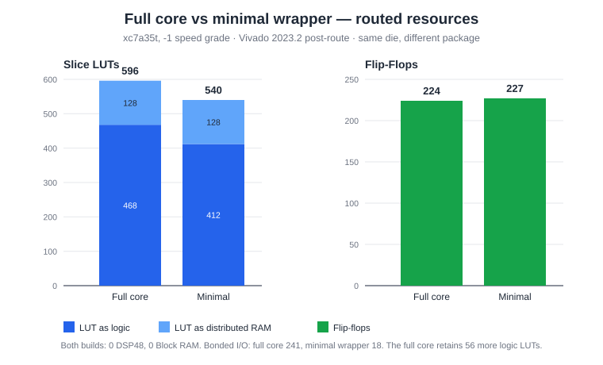

# Full-Core Characterization

This flow synthesizes **and** implements the complete `riscv_processor` core with
every debug port retained, so the resource and timing numbers reflect the whole
core rather than the logic the Basys3 minimal wrapper trims away.

## Why a different package

The full core exposes **241 I/O** (2 inputs + 239 debug output bits). The Basys3
package (`xc7a35tcpg236-1`, cpg236) has only **106 user I/O**, so the full core
cannot be placed on it — the minimal wrapper exists precisely to fit that I/O
budget by exposing a small subset of signals.

The characterization target is **`xc7a35tfgg484-1`**: the **same xc7a35t die and
-1 speed grade** as the Basys3 part, in the fgg484 package with **250 user I/O**.
Because the silicon is identical, the absolute logic counts, the -1 timing model,
and the utilization percentages are directly comparable to the Basys3 minimal and
jtag runs; only the package (and therefore the I/O count and thermal resistance)
differs. This is a pin-less characterization build, not a board image.

## Running it

```bash
make full-core
# or directly:
vivado -mode batch -source scripts/run_full_core.tcl
```

The flow (`scripts/run_full_core.tcl` + `constraints/riscv_processor_core.xdc`)
creates a fresh project, synthesizes, implements to `route_design` (no bitstream),
and writes the report set below to `build/reports/`. The core clock is constrained
at 50 MHz (20 ns) to match the deployed `clk_core`; reset is a false path; all
ports default to LVCMOS33 and pin locations are auto-assigned by the placer.

## Resource utilization (post-route, verified)

Reproduced from `build/reports/utilization_full_impl.rpt` (Vivado 2023.2, routed,
xc7a35tfgg484-1).



*Figure derived from the routed utilization reports. Vivado batch writes text
reports, so this SVG chart is generated from them.*

| Resource | Used | Available | Utilization |
|----------|------|-----------|-------------|
| Slice LUTs | 596 | 20,800 | 2.87% |
| — LUT as logic | 468 | 20,800 | 2.25% |
| — LUT as distributed RAM | 128 | 9,600 | 1.33% |
| Slice registers (FF) | 224 | 41,600 | 0.54% |
| F7 muxes | 64 | 16,300 | 0.39% |
| F8 muxes | 32 | 8,150 | 0.39% |
| Block RAM | 0 | 50 | 0% |
| DSP48E1 | 0 | 90 | 0% |
| BUFGCTRL | 1 | 32 | 3.13% |
| Bonded I/O | 241 | 250 | 96.40% |

All 224 registers are `FDRE` (synchronous reset, clock enable). Key primitives:
239 OBUF + 2 IBUF, 224 FDRE, 128 RAMS64E (distributed RAM), 28 CARRY4, 64 MUXF7 +
32 MUXF8, and 575 LUTs of logic (LUT6 168 / LUT5 154 / LUT4 147 / LUT2 85 /
LUT3 20 / LUT1 1). The RV32M multiplier maps to **LUTs/CARRY4, not DSP48** — the
pre-optimization DSP inference report lists `A*B` patterns, but the routed netlist
uses 0 DSP blocks.

### Comparison with the Basys3 minimal wrapper

| Metric | Full core (fgg484) | Minimal wrapper (cpg236) |
|--------|--------------------|--------------------------|
| Slice LUTs | 596 | 540 |
| — logic LUTs | 468 | 412 |
| — distributed RAM | 128 | 128 |
| Flip-flops | 224 | 227 |
| DSP / Block RAM | 0 / 0 | 0 / 0 |
| Bonded I/O | 241 | 18 |
| WNS (setup) | +5.462 ns | +4.134 ns |
| Total power | 95 mW | 88 mW |

The full core keeps **56 more logic LUTs** (468 vs 412): this is the debug-
observability and datapath logic that the minimal wrapper optimizes away when its
unexposed core outputs become dangling. The minimal wrapper's 227 FF are 225 core
registers plus 2 asynchronous-set reset-synchronizer flops; the bare core has 224
FF and no synchronizer (see CDC below). The WNS and power differences come from
the different placement and I/O count, not a different core — both meet 50 MHz.

> Hierarchy note: synthesis flattens the ALU, control unit, immediate generator,
> divider, and instruction memory into the top, so `utilization_full_impl_hier.rpt`
> attributes the flattened logic to the three surviving instances (`dmem_inst`,
> `pc_inst`, `regfile_inst`) rather than giving a clean per-module split. The flat
> totals above are the accurate figures. A true per-module breakdown would require
> re-running synthesis with `keep_hierarchy`.

## Timing (post-route — all constraints met)

From `build/reports/timing_full_impl.rpt`, core clock `clk_core` = 50 MHz (20 ns):

| Metric | Value | Status |
|--------|-------|--------|
| WNS (setup) | +5.462 ns | MET |
| TNS | 0.000 ns (0 / 1696 endpoints) | MET |
| WHS (hold) | +0.241 ns | MET |
| THS | 0.000 ns (0 / 1696 endpoints) | MET |
| WPWS (pulse width) | +8.750 ns | MET |

`report_timing_summary`: **"All user specified timing constraints are met."**

The worst setup path (`build/reports/worst_paths_full_impl.rpt`) is
`pc_inst/pc_current_reg[9]` → `regfile_inst/registers_reg[4][16]`: the single-cycle
fetch → decode → register-file read → ALU → writeback → register-write path. Data
path delay **14.403 ns** (logic 4.090 ns / route 10.313 ns), 15 logic levels
(CARRY4×2, LUT2×2, LUT4×1, LUT5×2, LUT6×5, MUXF7×1, MUXF8×1, RAMS64E×1). The 5.462 ns
slack gives headroom to ~69 MHz; a pipeline stage would be needed to go faster
(v1.3.0 roadmap). `check_timing` reports 0 unconstrained internal endpoints, 0
combinational loops, and 0 registers without a clock.

## Power (vector-less estimate, medium confidence)

From `build/reports/power_full_impl.rpt`:

| Metric | Value |
|--------|-------|
| Total on-chip power | 95 mW |
| Dynamic | 24 mW |
| Device static | 72 mW |
| Junction temperature | 25.3 °C |

Dynamic power is dominated by the **241 I/O (22 mW)**; the core logic (slice logic,
signals, clocks, distributed RAM) is each <1 mW. Static power (72 mW) matches the
minimal run because it is the same die. The fgg484 package has a lower effective
θJA (2.8 °C/W) than cpg236 (5.0 °C/W).

## DRC, methodology, CDC, clock interaction

- **DRC** (`drc_full_impl.rpt`): 2 violations, both expected for a pin-less build —
  `UCIO-1` (Critical Warning: 241 ports have no LOC; this only blocks bitstream
  generation, which this flow does not run) and `CFGBVS-1` (Warning: configuration
  voltage properties unset). **Zero user-design logic violations.**
- **Methodology** (`methodology_full_impl.rpt`): 239 violations, all `TIMING-18`
  (missing input/output delay on the debug ports). These are observability outputs
  with no board interface, so no I/O delay is constrained. **Zero design-quality
  methodology violations.**
- **CDC** (`cdc_full_impl.rpt`): one crossing — the asynchronous `reset` input port
  → `clk_core`, 224 endpoints reported **Unknown** with a false-path exception.
  This is expected: the bare core has **no internal reset synchronizer**; the
  Basys3 minimal/jtag wrappers add a 2-FF `ASYNC_REG` synchronizer, which is why
  their CDC reports show Safe=1 / Unsafe=0 / Unknown=0. Reset synchronization is a
  wrapper responsibility, not a core bug.
- **Clock interaction** (`clock_interaction_full_impl.rpt`): single clock domain
  (`clk_core` → `clk_core`), classified **Clean / Timed**; the inter-clock table is
  empty (no crossings).

## Report set

`make full-core` writes these to `build/reports/`:

| File | Contents |
|------|----------|
| `utilization_full_synth.rpt` / `_impl.rpt` | Flat utilization (synth / routed) |
| `utilization_full_synth_hier.rpt` / `_impl_hier.rpt` | Hierarchical utilization |
| `timing_full_synth.rpt` / `_impl.rpt` | Timing summary |
| `worst_paths_full_impl.rpt` | Top 10 worst setup paths |
| `power_full_impl.rpt` | Power breakdown |
| `drc_full_impl.rpt` | Design rule checks |
| `methodology_full_impl.rpt` | Methodology checks |
| `cdc_full_impl.rpt` | Clock-domain crossings |
| `clock_interaction_full_impl.rpt` | Clock-pair classification |
| `clocks_full_impl.rpt` / `clock_util_full_impl.rpt` | Clock definitions / utilization |
| `control_sets_full_impl.rpt` | Unique control sets |
| `io_full_impl.rpt` | Per-port I/O detail |
| `check_timing_full_impl.rpt` | Constraint completeness |
| `congestion_full_impl.rpt` | Routing congestion |

## Related documents

- [Timing Analysis](timing.md)
- [Power Analysis](power.md)
- [Basys3 Build Guide](basys3-guide.md)
- [Wrapper Reference](../modules/wrappers.md)